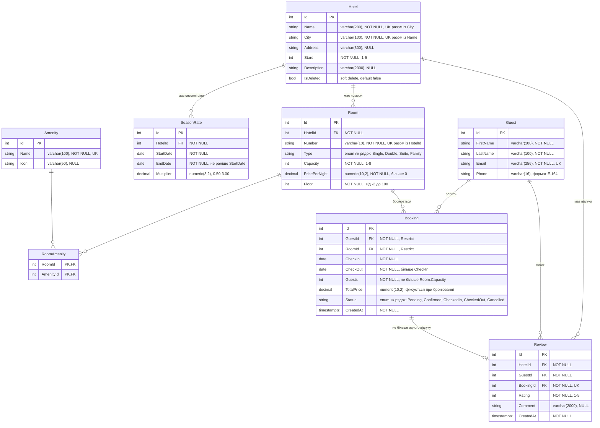

# ERD — модель даних Hotel Booking API

Діаграма описує цільову модель предметної області з [ТЗ](TZ.md#2-предметна-область).
Сутності з'являються в коді поступово (S3 — сутності, S4 — зв'язки), тому кожен PR,
що змінює модель, має оновлювати цей файл.

Позначення: **PK** — первинний ключ, **FK** — зовнішній ключ, **UK** — унікальність
(окремо або в парі з іншим полем, як вказано в коментарі).

## Зв'язки і кардинальність

| Зв'язок | Кардинальність | Як реалізовано |
|---|---|---|
| Hotel → Room | 1:N | `Room.HotelId` |
| Hotel → Review | 1:N | `Review.HotelId` |
| Hotel → SeasonRate | 1:N | `SeasonRate.HotelId` |
| Room ↔ Amenity | M:N | проміжна таблиця `RoomAmenity` (складений PK `RoomId + AmenityId`) |
| Guest → Booking | 1:N | `Booking.GuestId`, видалення гостя з бронюваннями заборонене (`Restrict`) |
| Room → Booking | 1:N | `Booking.RoomId`, видалення номера з бронюваннями заборонене (`Restrict`) |
| Guest → Review | 1:N | `Review.GuestId` |
| Booking → Review | 1:0..1 | `Review.BookingId` з унікальним індексом |

## Пояснення неочевидних рішень

- **Booking — окрема сутність, а не зв'язок M:N між Guest і Room.** Бронювання несе
  власні дані (дати, кількість гостей, вартість, статус), а один гість може кілька разів
  бронювати той самий номер на різні дати. Простий M:N цього не дозволяє (ТЗ, розд. 2.3).
- **`RoomAmenity` — «чиста» проміжна таблиця.** У зв'язку номер–зручність немає власних
  даних, тому складений первинний ключ `(RoomId, AmenityId)` одночасно забороняє дублікати.
- **Відгук прив'язаний до бронювання (`BookingId` унікальний).** Так у базі гарантується
  правило «один відгук на бронювання». Перевірку «лише після проживання» (статус `CheckedOut`)
  робить сервіс, бо це умова на стан іншої таблиці.
- **`Review.HotelId` дублює шлях Booking → Room → Hotel.** ТЗ описує зв'язок «готель має
  багато відгуків» напряму; окремий FK робить запит середнього рейтингу готелю простим
  і швидким, без трьох JOIN.
- **`TotalPrice` зберігається в бронюванні**, а не обчислюється з `PricePerNight`: ціна
  номера і сезонні коефіцієнти можуть змінитися, а вартість фіксується в момент бронювання.
- **Гроші — `decimal` → `numeric(10,2)`**, а не `double`: без похибок округлення.
- **Enum-и (`Room.Type`, `Booking.Status`) зберігаються як рядки** (`HasConversion<string>()`):
  значення читаються в базі, і додавання нового значення не зсуває старі числові коди.
- **`Restrict` для FK бронювання.** Каскадне видалення гостя чи номера знищило б історію
  бронювань. Для готелю передбачено soft delete (`IsDeleted`), тож фізично він не видаляється.
- **Захист від подвійного бронювання** забезпечує обмеження PostgreSQL на перетин інтервалів
  `[CheckIn, CheckOut)` для одного `RoomId` (крім `Cancelled`) — окрема задача #52.

## Що буде додано окремими задачами

- аудит `CreatedAt` / `UpdatedAt` для основних сутностей — #41;
- оптимістична конкурентність ціни номера (системна колонка PostgreSQL `xmin`) — #42;
- зв'язок `Guest` з обліковим записом користувача — задачі безпеки (S7).

Довжини `Guest.Email` (256) і `Guest.Phone` (16 = «+» і до 15 цифр за E.164), а також
унікальність `Amenity.Name` у задачах не задані явно — це пропозиції, які варто погодити
в рев'ю.
